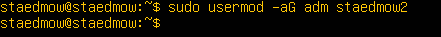
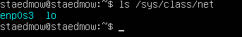
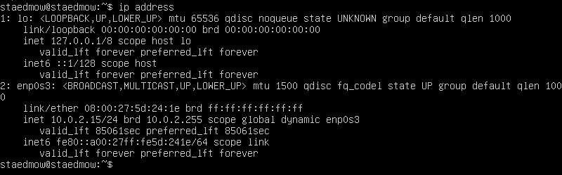
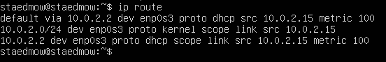
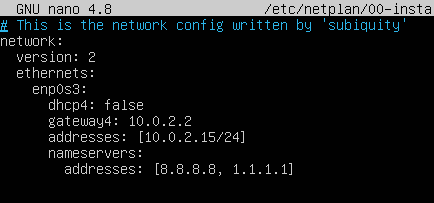
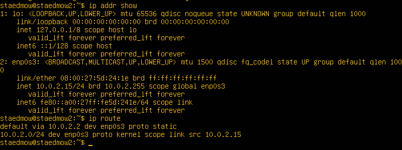
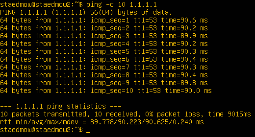
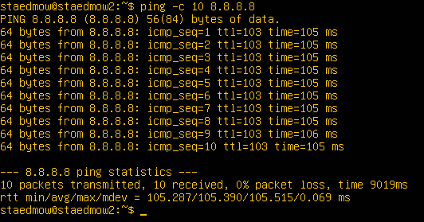
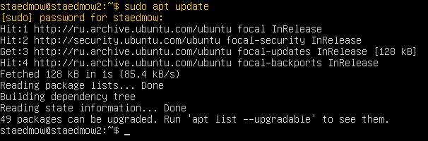

## Part 1. Установка ОС.

1. Вывод каманды cat /etc/issue (чтобы узнать версию Ubuntu):\

## Part 2. Создание пользователя.

1. Команда создания нового пользователя:\

2. Пользователь должен быть добавлен в группу adm:\

3. Вывод команды cat /etc/passwd:\

4. К какой группе принадлежит новый пользователь:\

## Part 3. Настройка сети ОС. 

1. Команда для смены имени машины:\

2. Команда для просмотра состояния времени:\
`sudo timedatetcl`

3. Команда для изменения часового пояса:\
`sudo timedatetcl set time-zone Asia/Yakutsk`

4. Измененный часовой пояс:\

5. Команда для вывода названия сетевых интерфейсов:\

6. IO - Это локальный интерфейс, который позволяет программам обращаться к этому компьютеру.\

7. IP-адресс:\

8. DHCP — это протокол клиента или сервера, который автоматически предоставляет узел протокола IP с его IP-адресом и другие связанные сведения о конфигурации, такие как маска подсети и шлюз по умолчанию.\

9. Внешний и внутренний ip адрес шлюза:\

10. Задание статичных сетевых настроек.
 Для задания статического IP-адреса, шлюза и DNS, необходимо отредактировать YAML-файл в директории /etc/netplan/:\
`sudo nano /etc/netplan/00-installer-config.yaml`\
\
После сохранения файла и применения новых настроек, выполняем следующую команду для применения конфигурации:\
`sudo netplan apply`

11. Перезагружаю виртуальную машину:\
`sudo reboot`\
Проверка сохранения статических настроек:\
`ip addr show`\
`ip route`\

12. Доступность хостов:\
`ping -c 10 1.1.1.1`\
\
`ping -c 10 8.8.8.8`\

## Part 4. Обновление ОС.

1. Обновление списка пакетов командой:\
`sudo apt update`\

2. Обновление всех установленных пакетов командой:\
`sudo apt upgrade`\

3. При повторном обновлении:\

## Part 5. Использование команды sudo.

`sudo` - команда, которая позволяет пользователю выполнять команды с привилегиями суперпользователя (root). Это позволяет администраторам системы и другим пользователям выполнять специфические задачи, требующие повышенных привилегий, например, установку программ или изменение системных файлов.\

1. Выдаю пользователю, созданному в `Part 2` root-права:\
`usermod -a -G sudo staedmow2`\

2. Проверяю наличие root-прав:\
`sudo -l -U staedmow2`\

3. Переключаю пользователя на staedmow2 и меняю hostname:\
`su - staedmow2`\
\
`sudo hostname staedmow2`\

4. Поменял hostname в файле /etc/hostnames и выполнил перезагрузку, чтобы изменения вступили в силу:\
`sudo nano /etc/hostname`\
\
`sudo reboot`

## Part 6. Установка и настройка службы времени.

1. Активировал NTP синхронизацию командой:\
`sudo timedatectl set-ntp true`

2. Проверка настроек синхронизации времени:\
`timedatectl show`\

## Part 7. Установка и использование текстовых редакторов.

1. Установка текстовых редакторов:\
`sudo apt install vim`\
`sudo apt install nano`\
`sudo apt install mcedit`\

2. Создаём и открываем файл командой:\
`vim test_vim.txt`\
`i - переключение в режим ввода`\
`Esc - переключение в командный режим`\
`:wq ,а затем Enter - выход с сохранением`\

3. Создаём и открываем файл командой:\
`nano test_nano.txt`\
`Ctrl+O - сохранение`\
`Enter - подтверждение имени файла`\
`Ctrl+X - выход`\

4. Создаём и открываем файл командой:\
`mcedit test_edit.txt`\
`F2 - сохраниение`\
`Enter - подтверждение`\
`F10 - выход`\

5. Редактирование и выход без сохраниения:
- vim:
`:q!` - выход без сохраниеня\

- nano:
`Ctrl+X + no` - выход и отказ от сохранения\

- mcedit:
`F10 + [NO]` - выход и отказ от сохранения\

6. Поиск и замена слова:
- vim:
`/слово` - поиск\
\
`:s/слово/замена` - замена\

- nano:\
`Ctrl + W` - поиск\

- mcedit:\
`F7` - поиск\

## Part 8. Установка и базовая настройка сервиса SSHD.
1. Установка службы SSHD:\
`sudo apt update`\
\
`sudo apt install openssh-server`\
2. Добавление автозапуска службы SSHD:\
`sudo systemctl enable ssh: systemctl status ssh`\

3. Перенастройка службы SSHD на порт 2022:\
`sudo nano /etc/ssh/sshd_config` - редактирование файла:
- Port 22 меняем на Port 2022\
\
`sudo systemctl restart ssh` - перезагрузка службы\
4. Проверка работы SSHD с помощью команды ps:\
`ps -A | grep sshd`\
\
`ps` - отображает информацию о работающих процессах

- Основные ключи команды ps:\
`-e`: Показывает все процессы в системе.\
`-u`: Показывает информацию о пользователях, запустивших процессы.\
`-x`: Показывает процессы, которые не связаны с терминалом.\
`-f`: Форматирует вывод более подробным образом, включая полный путь к исполняемому файлу и информацию о родительском процессе.\
`-l`: Показывает дополнительную информацию, такую как владелец процесса, группа, размер памяти и т.д.\
`-a`: Аналогично ключу -x, показывает процессы, не связанные с терминалом.\
`-A`: Показывает все процессы в системе, независимо от того, кто их запустил.\
`-m`: Показывает только процессы, связанные с сетью.\
`-n`: Не показывает процессы, которые не имеют идентификаторов процесса.\
`-o`: Позволяет пользователю определить формат вывода с помощью списка полей.

5. Перезагрузка системы:\
`sudo reboot`

6. Устанавливаем netstat:\
`sudo apt install net-tools`\

- Вывод комманды:\
`sudo netstat -tan`\

- Ключ -t отображает только TCP сокеты
- Ключ -a отображает все сокеты (listening and non-listening)
- Ключ -n отображает адреса и порты вместо имен

- Объяснение вывода netstat -tan:\
`Proto`: Протокол, используемый для соединения. Например, tcp или udp.\
`tcp`: Тип протокола.\
`Recv-Q`: Количество байтов, ожидающих прием в сокет. Это количество данных, которое еще не было прочитано приложением.\
`Send-Q`: Количество байтов, ожидающих отправку из сокета. Это количество данных, которое еще не было отправлено сетью.\
`0 0`: Стандартные значения, указывающие, что данные не отправлялись или не получены.\
`Local Address`: Локальный адрес и порт, на котором прослушивается соединение. 0.0.0.0 означает, что сокет прослушивает на всех доступных сетевых интерфейсах.\
`0.0.0.0:2022`: IP-адрес и порт, на котором прослушивается соединение. 0.0.0.0 означает, что сервер принимает соединения на указанном порту с любого IP-адреса.\
`Foreign Address`: Адрес и порт удаленного хоста, с которым установлено соединение. Если соединение не установлено, этот столбец может быть пустым.\
`State`: Состояние соединения.\
`LISTEN`: Состояние сокета, указывающее, что сервер готов принимать входящие соединения.

## Part 9. Установка и использование утилит top, htop.

1. Вывод команды top:\
`sudo top`\

2. Вывод команды htop:\
`sudo htop`\
`F6 - сортировка`

- сортировка по PID\

- сортировка по PERCENT_CPU\

- сортировка по PERCENT_MEM\

- сортировка по TIME\

- фильтр для процесса sshd\
`F4`\

- поиск процесса syslog\
`F3`\

- с добавленным выводом hostname, clock и uptime\
`F2`\

## Part 10. Использование утилиты fdisk.

1. Команда:\
`sudo fdisk -l`\

2. Название жесткого диска: /dev/sda\
   Размер жесткого диска: 25 GiB\
   Количество секторов: 24109056 секторов\
   У меня нет раздела подкачки, поэтому swap used 0, размер 2097148 байт.
`swapon -s`

## Part 11. Использование утилиты df.

1. `sudo df`\

- Размер раздела: 11758760 килобайт
- Размер занятого пространства: 4859220 килобайт
- Размер свободного пространства: 6280432 килобайт
- Процент использования: 44%
- Единица измерения: килобайт

2. `sudo df -Th`\

- Размер раздела: 12 ГБ
- Размер занятого пространства:4.7 ГБ
- Размер свободного пространства: 6.0 ГБ
- Процент использования: 44%
- Тип файловой системы: ext4

## Part 12. Использование утилиты du.

1. `du`\

2. Размер папок /home, /var, /var/log (в байтах, в человекочитаемом виде)\
`sudo du -hsb /var`\
`sudo du -hsb /var/log`\
`sudo du -hsb /home`\
\
`-s` означает "сводный", т.е. выводит общий размер директории\
`-b` означает "в байтах", т.е. выводит размер в байтах без преобразования в человекочитаемый вид\
`-h` означает "человекочитаемый", т.е. выводит размер в удобных для восприятия единицах (например, KB, MB, GB)

3. Размер всего содержимого в /var/log\
`sudo du -h /var/log/*`\

## Part 13. Установка и использование утилиты ncdu.

1. Установка утилиты:\
`sudo apt install ncdu`\

2. Вывод размера папок /home, /var, /var/log:\
`ncdu /home`\

3. `ncdu /var`\

4. `ncdu /var/log`\

## Part 14. Работа с системными журналами.

1. Для просмотра логов вводим команды:\
`cat /var/log/dmesg` - содержит сообщения ядра Linux, включая информацию о загрузке оборудования и других низкоуровневых событий\
`cat /var/log/syslog`- содержит системные сообщения, включая информацию о работе служб и приложений\
`cat /var/log/auth.log`  - содержит информацию о событиях аутентификации, включая попытки входа в систему и успешные авторизации

2. Последняя успешная авторизация:\
`cat /var/log/auth.log | grep 'session opened'`\
\
Время: 22:58:51\
Имя: staedmow2\
Метод: (uid=0) означает, что сессия была открыта для другого пользователя системой или процессом, работающим с правами суперпользователя.

3. Перезагрузка SSHD:\
`sudo systemctl restart sshd`\
`cat /var/log/auth.log | grep 'restart'`\

## Part 15. Использование планировщика заданий CRON.

1. Для запуска cron нужно установить его командой: sudo apt install cron. Добавляем задание в cron:\
`crontab -e`\
Добавляем строку `*/2 * * * * uptime` в конец файла.\

2. Ищем в журнале строчки о выполнении:\
`cat /var/log/syslog | grep uptime`

3. Список текущих заданий:\
`crontab -l`\

4. Удаление всех заданий:\
`crontab -r`\
