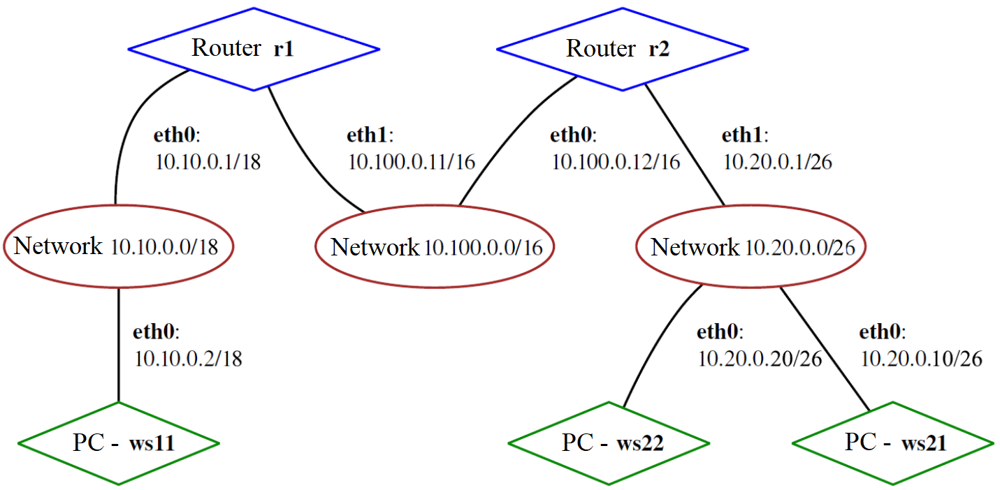

## Сети в Linux

Настройка сетей в Linux на виртуальных машинах.

## Contents

1. [Инструмент ipcalc](#part-1-инструмент-ipcalc)
2. [Статическая маршрутизация между двумя машинами](#part-2-статическая-маршрутизация-между-двумя-машинами)
3. [Утилита iperf3](#part-3-утилита-iperf3)
4. [Сетевой экран](#part-4-сетевой-экран)
5. [Статическая маршрутизация сети](#part-5-статическая-маршрутизация-сети)
6. [Динамическая настройка IP с помощью DHCP](#part-6-динамическая-настройка-ip-с-помощью-dhcp)
7. [NAT](#part-7-nat)
8. [Дополнительно. Знакомство с SSH Tunnels](#part-8-дополнительно-знакомство-с-ssh-tunnels)

## Part 1. Инструмент ipcalc

### 1.1. Сети и маски

`ipcalc` это утилита для выполнения расчетов и анализа IP-адресов и масок подсети.
Она позволяет выполнять различные операции, такие как:
- вычисление адреса сети;
- определение широковещательного адреса;
- расчет количества доступных хостов в подсети;
- определение минимального и максимального IP-адресов в подсети;
- проверка валидности IP-адресов и масок подсети и многое другое.

Для установки утилиты выполните следующую команду в терминале: `sudo apt install ipcalc`.

1. Адрес сети `ipcalc 192.167.38.54/13`.

.png)

2. Перевод маски

`ipcalc 255.255.255.0` в префиксную и двоичную запись.

.png)

`ipcalc /15` в обычную и двоичную запись.

.png)

`ipcalc /28` в обычную и двоичную запись.

.png)

3. Минимальный и максимальный хост в сети при масках `/8`, `/16`, `/23`, `/4`.

`ipcalc 12.167.38.4/8`

.png)

`ipcalc 12.167.38.4/16`

.png  )

`ipcalc 12.167.38.4 255.255.254.0` or `ipcalc 12.167.38.4/23`

.png)

`ipcalc 12.167.38.4/4`

.png)

### 1.2. localhost

`localhost` - это стандартное сетевое имя для компьютера или устройства, которое ссылается на себя, на тот компьютер или устройство, на котором выполняется запрос или операция.

Обычно `localhost` связан с IP-адресом `127.0.0.1` в IPv4 или `::1` в IPv6. Эти адреса зарезервированы для целей тестирования и локальной разработки и не отправляют трафик в сеть.

.png)

Из предоставленных IP-адресов только `127.0.0.2` и `127.1.0.1` обращаются к `localhost`. Это можно понять по тому, что они начинаются с префикса `127`, который зарезервирован для loopback-адресов в IPv4. Такие адреса используются для обращения к устройству, на котором выполняется запрос, то есть к `localhost`.

### 1.3. Диапазоны и сегменты сетей

Публичные IP-адреса:
- публичные IP-адреса предназначены для использования в глобальной сети Интернет;
- они уникальны и могут быть использованы для идентификации конкретного устройства в глобальной сети;
- публичные IP-адреса используются для связи между устройствами через Интернет, обеспечивая обмен данными между компьютерами и серверами по всему миру;
- примеры публичных IP-адресов: 8.8.8.8 (Google Public DNS), 216.58.214.46 (IP-адрес google.com).

Частные IP-адреса:
- частные IP-адреса предназначены для использования в локальных сетях (например, домашние сети, офисные сети, внутренние сети предприятий);
- они не уникальны и могут повторяться в различных локальных сетях, так как не должны использоваться в глобальной сети;
- частные IP-адреса обеспечивают связь и обмен данными между устройствами внутри одной локальной сети, но не доступны напрямую извне сети Интернет;
- примеры частных IP-адресов: 192.168.0.1, 10.0.0.1, 172.16.0.1.

1. Какие из перечисленных IP можно использовать в качестве публичного, а какие в качестве частных: `10.0.0.45`, `134.43.0.2`, `192.168.4.2`, `172.20.250.4`, `172.0.2.1`, `192.172.0.1`, `172.68.0.2`, `172.16.255.255`, `10.10.10.10`, `192.169.168.1`.

.png)

IP-адреса `134.43.0.2`, `172.0.2.1`, `192.172.0.1`, `172.68.0.2`, `192.169.168.1` можно использовать в качестве публичных.

IP-адреса `10.0.0.45`, `192.168.4.2`, `172.20.250.4`, `172.16.255.255`, `10.10.10.10` можно использовать в качестве частных.

2. Какие из перечисленных IP-адресов шлюза возможны у сети `10.10.0.0/18`: `10.0.0.1`, `10.10.0.2`, `10.10.10.10`, `10.10.100.1`, `10.10.1.255`.

.png)

Таким образом, возможными шлюзами для сети `10.10.0.0/18` являются адреса `10.10.0.2`, `10.10.10.10` и `10.10.1.255`.

## Part 2. Статическая маршрутизация между двумя машинами

- Виртуальная машина `ws1`

С помощью команды `ip a` посмотрел существующие сетевые интерфейсы.
.png)

Задал следующий адрес и маску: 192.168.100.10, маска /16. Для этого использовал команду `sudo vim /etc/netplan/00-installer-config.yaml`.
.png)

Затем выполнил команду `sudo netplan apply` и перезагрузил систему `reboot`.
.png)

- Виртуальная машина `ws2`

С помощью команды `ip a` посмотрел существующие сетевые интерфейсы.
.png)

Задал следующий адрес и маску: 172.24.116.8, маска /12. Для этого использовал команду `sudo vim /etc/netplan/00-installer-config.yaml`.
.png)

Затем выполнил команду `sudo netplan apply` и перезагрузил систему `reboot`.
.png)

### 2.1. Добавление статического маршрута вручную

С помощью команды `ip r add <ip-адрес> dev enp0s8` добавил статистический маршрут от одной машины до другой и обратно. После использовал команду `ping <ip-адрес> -c 4`, чтобы проверить соединение между виртуальными машинами.

- Виртуальная машина `ws1`

.png)

- Виртуальная машина `ws2`

.png)

### 2.2. Добавление статического маршрута с сохранением

Перезагрузил машины командой `reboot`. Добавил статистический маршрут от одной машины до другой с помощью файла `etc/netplan/00-installer-config.yaml`. После пропинговал соединение между виртуальными машинами.

- Виртуальная машина `ws1`

.png)
.png)w

- Виртуальная машина `ws2`

.png)
.png)

## Part 3. Утилита iperf3

`iperf3` - это утилита для тестирования пропускной способности сети. Она позволяет измерять пропускную способность (скорость передачи данных) между двумя узлами в сети.

### 3.1. Скорость соединения

1. 8 MBps в MB/s:
`8 MBps = 1 MB/s`;

2. 100 MB/s в Kbps:
`100 MB/s * 1024 * 8 = 819200 Kbps`;

3. 1 Gbps в Mbps;
`1 Gbps = 1024 Mbps`;

### 3.2. Утилита iperf3

Измерил скорость соединения между ws1 и ws2. Для этого ws1 был настроен в качестве сервера, используя команду `iperf3 -s`. ws2 выступал в роли клиента, используя команду `iperf3 -c <ip-адрес>`. Эти команды позволяют измерить пропускную способность сети между двумя узлами.

- Виртуальная машина `ws1`

.png)

- Виртуальная машина `ws2`

.png)

## Part 4. Сетевой экран

`iptables` - это утилита для управления правилами фильтрации пакетов и NAT. С помощью `iptables` вы можете настраивать правила безопасности для вашей сети, определяя, какие пакеты разрешены, запрещены или перенаправляются.

### 4.1. Утилита iptables

- Виртуальная машина `ws1`

Создал файл используя команду `sudo vim /etc/firewall.sh`.

.png)

Запустил файл с командами `chmod +x /etc/firewall.sh` и `/etc/firewall.sh`.

.png)

- Виртуальная машина `ws2`

Создал файл используя команду `sudo vim /etc/firewall.sh`.

.png)

Запустил файл с командами `chmod +x /etc/firewall.sh` и `/etc/firewall.sh`.

.png)

Правила в `iptables` выполняются по порядку, начиная с верхнего и двигаясь к нижнему, пока не будет найдено совпадение с правилом. Когда пакет соответствует правилу с действием `DROP`, выполнение цепочки правил прекращается, и пакет немедленно отбрасывается. Даже если в последующих правилах есть другие правила.

### 4.2. Утилита nmap

`Nmap` (Network Mapper) - это утилита командной строки для сканирования сети и анализа сетевых хостов. Она предоставляет возможности для обнаружения устройств в сети, определения открытых портов, определения служб, работающих на этих портах, а также для сканирования уязвимостей и анализа сетевой конфигурации.

- Виртуальная машина `ws1`

Пингую `ws2`.

.png)

- Виртуальная машина `ws2`

Пингую `ws1`. `ws1` не пигуется.

.png)

## Part 5. Статическая маршрутизация сети

Сеть:

Поднял пять виртуальных машин (3 рабочие станции (ws11, ws21, ws22) и 2 роутера (r1, r2)).

### 5.1. Настройка адресов машины

Настроил конфигурации машин в `/etc/netplan/00-installer-config.yaml` и подтвердил изменения командой `sudo netplan apply`.

- Виртуальная машина `ws11`

.png)

- Виртуальная машина `r1`

.png)

- Виртуальная машина `ws21`

.png)

- Виртуальная машина `ws22`

.png)

- Виртуальная машина `r2`

.png)

Перезапустил с помощью `reboot`. Командой `ip -4 a` проверил, что адреса машин заданы верно. Также пропинговал `ws22` с `ws21`. Аналогично пропинговал `r1` с `ws11`.

- Виртуальная машина `ws11` -> `r1`

.png)

- Виртуальная машина `r1`

.png)

- Виртуальная машина `ws21` -> `ws22`

.png)

- Виртуальная машина `ws22`

.png)

- Виртуальная машина `r2`

.png)

### 5.2. Включение переадресации IP-адресов

Включил переадресацию IP командой `sudo sysctl -w net.ipv4.ip_forward=1`. *При таком подходе переадресация не будет работать после перезагрузки системы*.

- Виртуальная машина `r1`

.png)

- Виртуальная машина `r2`

.png)

Открыл файл `sudo nano /etc/sysctl.conf` и раскомментировал строку `net.ipv4.ip_forward = 1`. *При использовании этого подхода, IP-переадресация включена на постоянной основе*.

- Виртуальная машина `r1`

.png)

- Виртуальная машина `r2`

.png)

### 5.3. Установка маршрута по-умолчанию

Настроил маршрут по-умолчанию (шлюз) для рабочих станций. Для этого добавил `default` перед `IP` роутера в файле конфигураций.

- Виртуальная машина `ws11`

.png)

- Виртуальная машина `ws21`

.png)

- Виртуальная машина `ws22`

.png)

Вызвал `ip r` для рабочих станций.

- Виртуальная машина `ws11`

.png)

- Виртуальная машина `ws21`

.png)

- Виртуальная машина `ws22`

.png)

Пропинговал с `ws11` роутер `r2`. Для ws1 использовал команду `ping 10.100.0.12 -c 4`, а для `r2` - `sudo tcpdump -tn -i enp0s8`.

- Виртуальная машина `ws11` -> `r2`

.png)
.png)

Команда `tcpdump` в Linux системе представляет собой утилиту командной строки, которая используется для захвата и анализа сетевого трафика. Комбинация флагов `-tn` и `-i` в команде tcpdump указывает утилите захватывать пакеты с указанного сетевого интерфейса `(-i)`, одновременно отключая вывод времени захвата пакета `(-t)` и отключая преобразование IP-адресов и портов в их имена `(-n)`.

### 5.4. Добавление статических маршрутов

Добавил в роутеры `r1` и `r2` статические маршруты в файле конфигураций `/etc/netplan/00-installer-config.yaml`.

- Виртуальная машина `r1`

.png)

- Виртуальная машина `r2`

.png)

Применил изменения командой `sudo netplan apply` и вызвал `ip r`.

- Виртуальная машина `r1`

.png)

- Виртуальная машина `r2`

.png)

Запустил команды `ip r list 10.10.0.0/[маска сети]` и `ip r list 0.0.0.0/0` на `ws11`.

- Виртуальная машина `ws11`

.png)

В процессе выбора маршрута сетевые устройства учитывают приоритет каждого маршрута. Более специфичные маршруты имеют более высокий приоритет перед маршрутами по умолчанию.

### 5.5. Построение списка маршрутизаторов

`traceroute` - это утилита командной строки, которая используется для отслеживания маршрута следования пакетов в сети от исходного узла к целевому узлу. Она помогает определить путь, который пакеты проходят от отправителя к получателю, а также время, затраченное на прохождение каждого узла на этом пути.

Запустил на `r1` команду дампа `sudo tcpdump -tnv -i enp0s9`, а на `ws11` команду `traceroute 10.100.0.12`.

.png)
.png)

### 5.6. Использование протокола ICMP при маршрутизации

`ICMP` (Internet Control Message Protocol) - это протокол управляющих сообщений, который используется для передачи информации об ошибках и управления сетью в сетях TCP/IP.

В контексте утилиты `tcpdump`, когда вы используете флаг `-i`, `tcpdump` будет захватывать и выводить пакеты, использующие протокол `ICMP`. Эти пакеты могут включать различные типы ICMP-сообщений, такие как эхо-запросы (ping), ответы на эхо-запросы, сообщения об ошибках маршрутизации и другие управляющие сообщения.

Запустил на `r1` перехват сетевого трафика, проходящего через `eth0` с помощью команды: `tcpdump -n -i eth0 icmp`. Пропинговал с `ws11` несуществующий IP (например, 10.30.0.111) с помощью команды: `ping 10.30.0.111 -c 1`.

.png)
.png)

## Part 6. Динамическая настройка IP с помощью DHCP

Для `r2` настроил в файле `/etc/dhcp/dhcpd.conf` конфигурацию служб DHCP:

1. Указал адрес маршрутизатора по-умолчанию, DNS-сервера и адреса внутренней сети.

.png)

2. В файле `resolv.conf` прописал `nameserver 8.8.8.8`.

.png)

Перезагрузил службы DHCP командой `systemctl restart isc-dhcp-server`. Машину `ws21` перезагрузил при помощи `reboot` и через `ip a` показал, что она получила адрес. Также пропинговал `ws22` с `ws21`.

.png)
.png)

Указал MAC адрес у `ws11`, для этого в `etc/netplan/00-installer-config.yaml` добавил строки: `macaddress: 10:10:10:10:10:BA`, `dhcp4: true`.

.png)

Для `r1` настроил аналогично `r2`, но сделал выдачу адресов с жесткой привязкой к MAC-адресу (`ws11`).

.png)
.png)
.png)
.png)

Запросил с `ws21` ip адреса до и после обновления.

- `ip a` до обновления:

.png)

- `ip a` после обновления:

.png)

- `dhclient -r enp0s8`: Эта команда освобождает текущий IP-адрес для сетевого интерфейса enp0s8.
- `dhclient -v enp0s8`: Эта команда запрашивает новый IP-адрес для сетевого интерфейса enp0s8 и выводит подробную информацию о процессе.

## Part 7. NAT

`NAT` (Network Address Translation) - это технология, которая преобразует IP-адреса и порты в сети. Она позволяет нескольким устройствам в локальной сети использовать один общий публичный IP-адрес для доступа в интернет. Также NAT обеспечивает безопасность, скрывая внутренние IP-адреса от внешней сети.

`Apache2` - это программное обеспечение для веб-сервера, которое обрабатывает запросы от веб-браузеров и поставляет веб-сайты и веб-приложения через протоколы HTTP (обычный) и HTTPS (шифрованный). Если у вас нет утилиты `Apache2`, установите её с помощью команды: `sudo apt install apache2`.

В файле `sudo vim /etc/apache2/ports.conf` на `ws22` и `r1` изменил строку `Listen 80` на `Listen 0.0.0.0:80`, то есть сделал сервер Apache2 общедоступным.

- Виртуальная машина `ws22`

.png)

- Виртуальная машина `r1`

.png)

Запустил веб-сервер Apache командой `sudo service apache2 start` на `ws22` и `r1`.

- Виртуальная машина `ws22`

.png)

- Виртуальная машина `r1`

.png)

Создал firewall командой `sudo vim /etc/firewall.sh` и добавил следующие правила:

- Виртуальная машина `r2`

.png)

Запустил файл с помощью команды: `sudo chmod +x /etc/firewall.sh` и `sudo sh /etc/firewall.sh`.

Проверил соединение между `ws22` и `r1` командой `ping 10.20.0.20 -c 4`. *При запуске файла с этими правилами, ws22 не должна «пинговаться» с r1*.

- Виртуальная машина `r1` -> `ws22`

.png)

Добавил в файл ещё одно правило:

Для разрешения маршрутизации всех пакетов протокола ICMP с помощью iptables вам нужно добавить правило в цепочку INPUT или FORWARD в таблице filter: `iptables -A INPUT -p icmp -j ACCEPT` или `sudo iptables -A FORWARD -p icmp -j ACCEPT`.

- Виртуальная машина `r2`

.png)

Запустил файл также, как и выше. Проверил соединение между `ws22` и `r1` командой `ping 10.20.0.20 -c 4`. *При запуске файла с этими правилами, ws22 должна «пинговаться» с r1*.

- Виртуальная машина `r1` -> `ws22`

.png)

Добавил в файл ещё два правила:

- Включил SNAT, а именно маскирование всех локальных ip из локальной сети, находящейся за r2 (по обозначениям из Части 5 - сеть 10.20.0.0).

- Включил DNAT на 8080 порт машины r2 и добавил к веб-серверу Apache, запущенному на ws22, доступ извне сети.

.png)

Запустил файл также, как 4 и 7 частях. Проверил соединение по TCP для SNAT: для этого с `ws22` подключился к серверу Apache на `r1` командой: `telnet <ip-адресс> [port]`, а так же проверил соединение по TCP для DNAT: для этого с `r1` подключился к серверу Apache на `ws22` командой `telnet` (обращаться по адресу `r2` и порту `8080`).

- Виртуальная машина `ws22` -> `r1`

.png)

- Виртуальная машина `r1` -> `ws22`

.png)

## Part 8. Дополнительно. Знакомство с SSH Tunnels

*В данном задании используются виртуальные машины из Части 5.*

Запустил на r2 фаервол с правилами из Части 7.

.png)

Запустил веб-сервер **Apache** на ws22 только на localhost (то есть в файле */etc/apache2/ports.conf* измени строку `Listen 80` на `Listen localhost:80`).

.png)

.png)

Воспользовался *Local TCP forwarding* с ws21 до ws22, чтобы получить доступ к веб-серверу на ws22 с ws21.

- Установил openssh-server на ws11, ws21 и ws22:

.png)

- Чтобы воспользоваться `Local TCP forwarding` с ws21 до ws22 необходимо воспользоватья командой типа `ssh -L [local_port]:[remote_ip]:[remote_port] [user]@[remote_ip]` на ws21:

.png)

.png)

- Необходимо для `Remote TCP forwarding` с ws11 до ws22 открыть порт 22(SSH) у "файрволла" на r2:

.png)

.png)

- Чтобы воcпользоваться `Remote TCP forwarding` с ws11 до ws22 необходимо воспользоватья командой типа `ssh -R [local_port]:[remote_ip]:[remote_port] [user]@[remote_ip]` на ws11:

.png)

- Для проверки подключения между ws11 и ws22 необходимо ввести команду `telnet 127.0.0.1 [local_port]` на ws11:

.png)

- Для проверки подключения между ws21 и ws22 необходимо ввести команду `telnet 127.0.0.1 [local_port]` на ws21:

.png)