## Part 1. Настройка gitlab-runner

Подними виртуальную машину Ubuntu Server 22.04 LTS.
Будь готов, что в конце проекта нужно будет сохранить дамп образа виртуальной машины.\
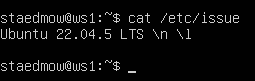

Скачай и установи на виртуальную машину gitlab-runner.\
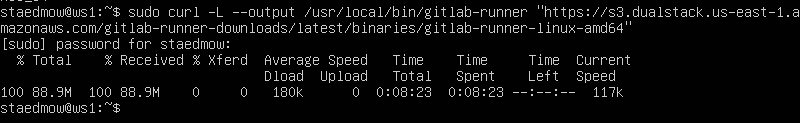

Запусти gitlab-runner и зарегистрируй его для использования в текущем проекте (DO6_CICD).\
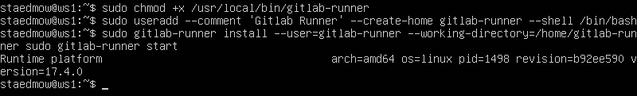

Для регистрации понадобятся URL и токен, которые можно получить на страничке задания на платформе.\
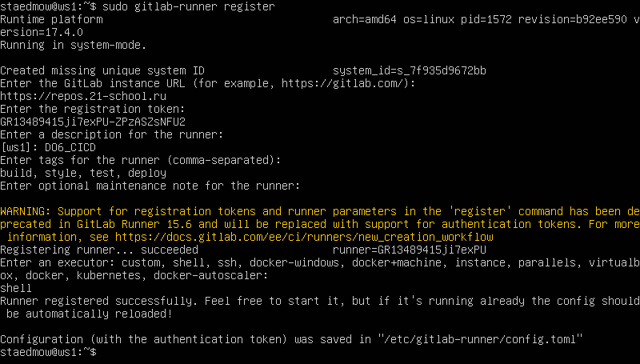

## Part 2. Сборка

Напиши этап для CI по сборке приложений из проекта C2_SimpleBashUtils.

В файле gitlab-ci.yml добавь этап запуска сборки через мейк файл из проекта C2.\
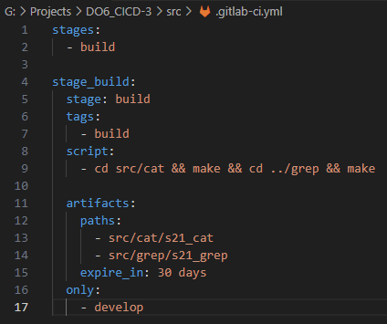

Файлы, полученные после сборки (артефакты), сохрани в произвольную директорию со сроком хранения 30 дней.

Возникла ошибка:\
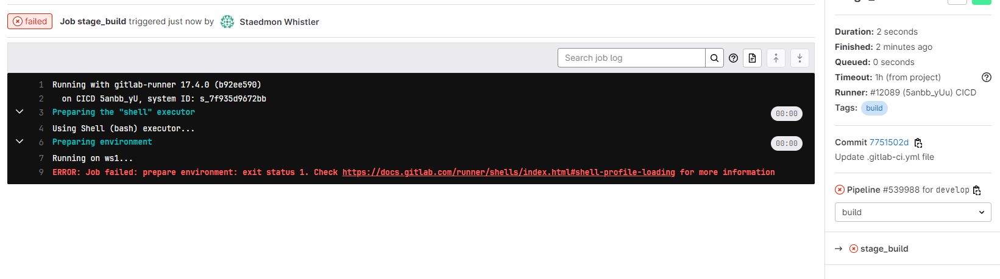

Убираем очистку экрана\
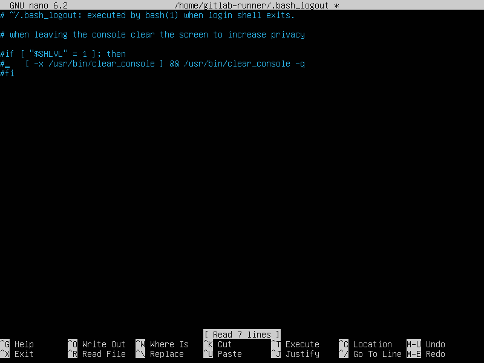

Запускается без проблем:\
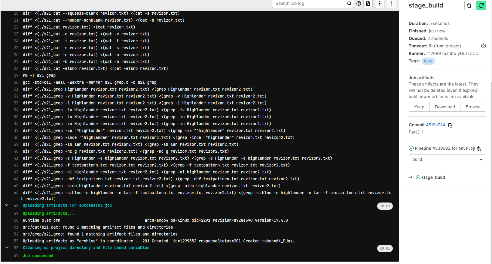

## Part 3. Тест кодстайла

Напиши этап для CI, который запускает скрипт кодстайла (clang-format).\
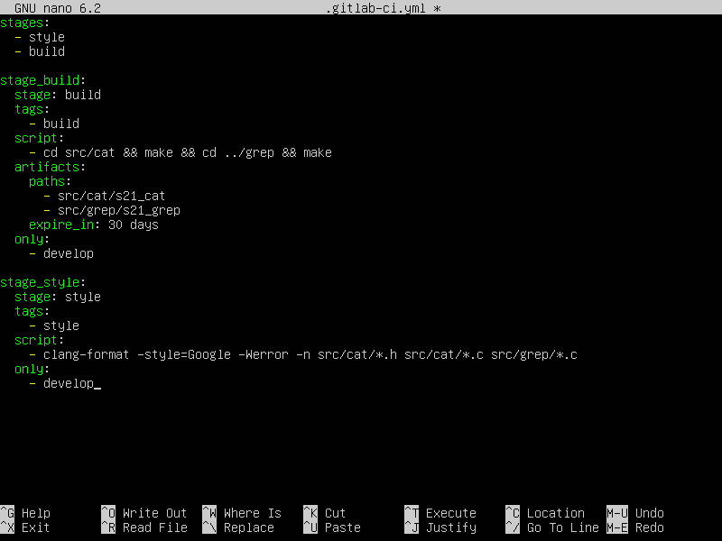

Если кодстайл не прошел, то «зафейли» пайплайн.\

В пайплайне отобрази вывод утилиты clang-format.\
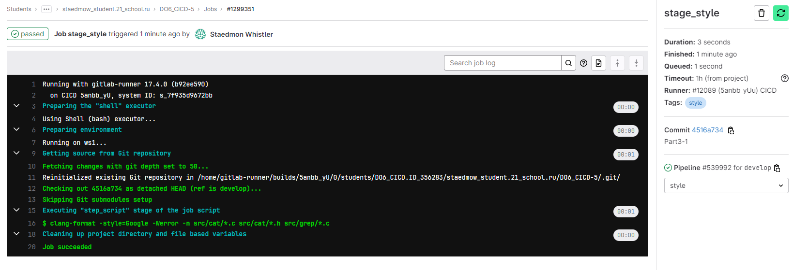

## Part 4. Интеграционные тесты

Напиши этап для CI, который запускает твои интеграционные тесты из того же проекта.\
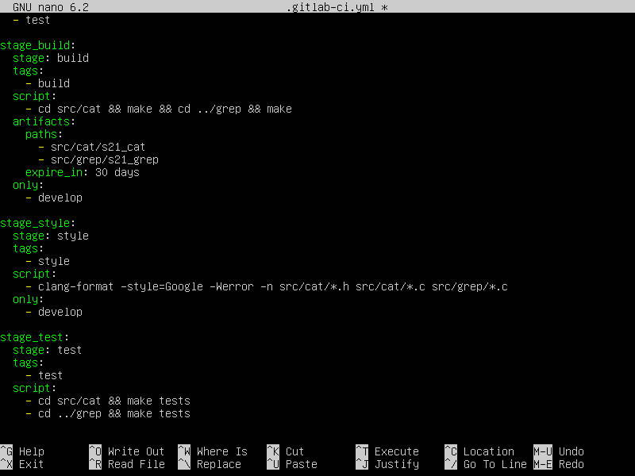

Запусти этот этап автоматически только при условии, если сборка и тест кодстайла прошли успешно.

Если тесты не прошли, то «зафейли» пайплайн.

В пайплайне отобрази вывод, что интеграционные тесты успешно прошли / провалились.\
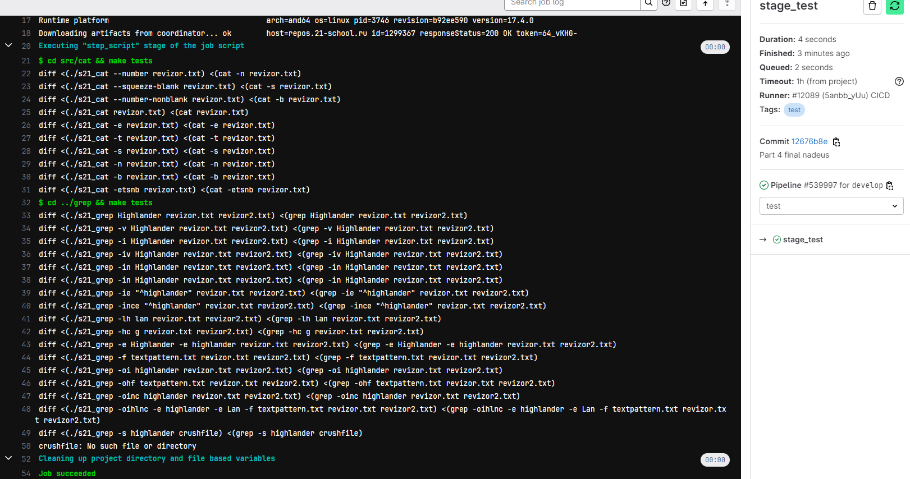

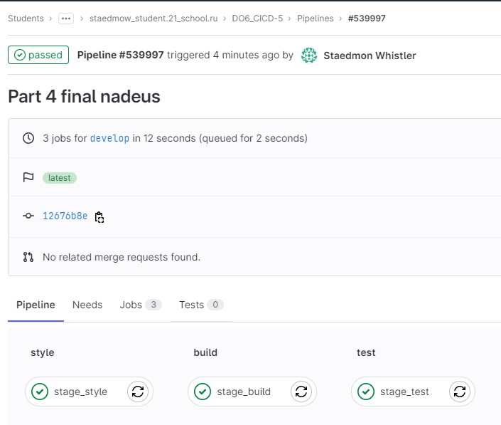

## Part 5. Этап деплоя

Подними вторую виртуальную машину Ubuntu Server 22.04 LTS.
Напиши этап для CD, который «разворачивает» проект на другой виртуальной машине.

Запусти этот этап вручную при условии, что все предыдущие этапы прошли успешно.

Напиши bash-скрипт, который при помощи ssh и scp копирует файлы, полученные после сборки (артефакты), в директорию /usr/local/bin второй виртуальной машины.
Тут тебе могут помочь знания, полученные в проекте DO2_LinuxNetwork.

Будь готов объяснить по скрипту, как происходит перенос.

В файле gitlab-ci.yml добавь этап запуска написанного скрипта.

В случае ошибки «зафейли» пайплайн.
В результате ты должен получить готовые к работе приложения из проекта C2_SimpleBashUtils (s21_cat и s21_grep) на второй виртуальной машине.

Сохрани дампы образов виртуальных машин.
P.S. Ни в коем случае не сохраняй дампы в гит!

Не забудь запустить пайплайн с последним коммитом в репозитории.\
1) Создаем клон ws2\
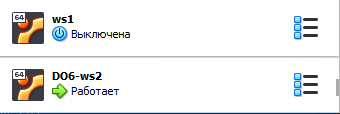

2) Задаем статическую маршрутизацию\
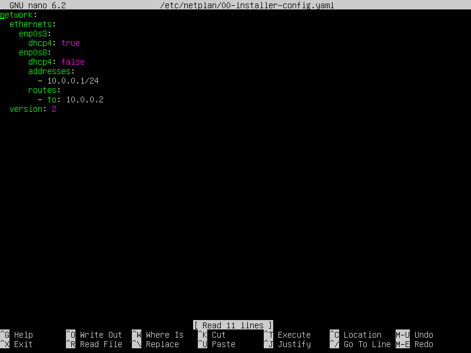\
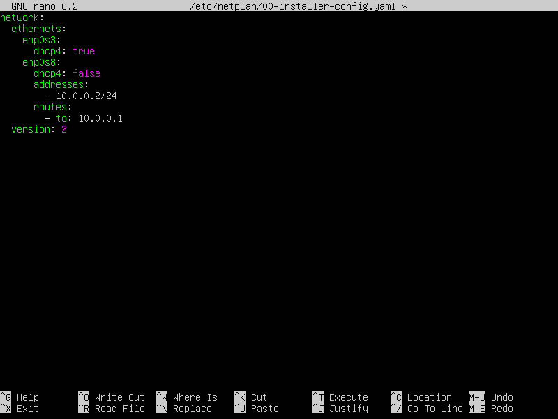

3) Пингуем, проверяем связь\
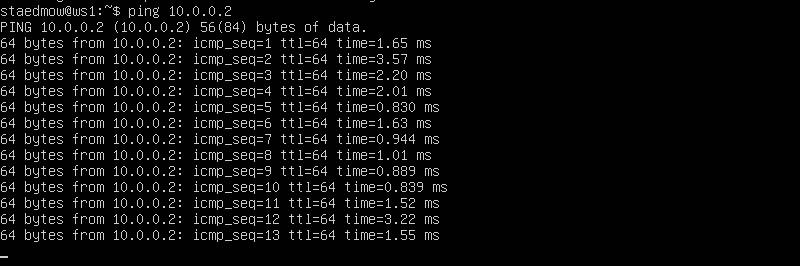

Важно! После проброса портов обязательно:

на машине где деплоим проект сменить пользователя на gitlab-runner: sudo su -l gitlab-runner -s /bin/bash
создать ssh ключ и закинуть его с помощью ssh-copy-id на вторую машину: ssh-keygen и ssh-copy-id staedmow@10.0.0.2
на машине куда отправляем файлы дать права суперпользователя нашему юзеру, от чьего имени происходит логин: sudo usermod -aG sudo staedmow
на машине куда отправляем файлы дать права на изменение папки /usr/local/bin: sudo chmod 777 /usr/local/bin
Теперь scp будет нормально работать и копировать файлы в системную папку!

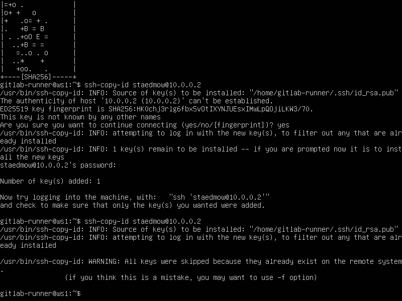\
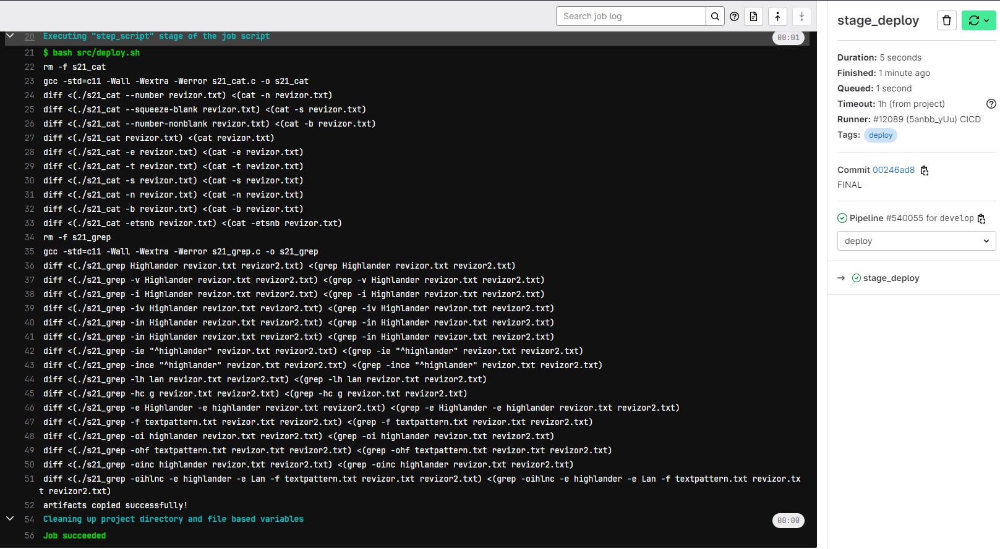

## Part 6. Дополнительно. Уведомления

Настрой уведомления об успешном/неуспешном выполнении пайплайна через бота с именем «[твой nickname] DO6 CI/CD» в Telegram.

1) C помощью BotFather создаем бота (несложно)
2) Напишем скрипт\
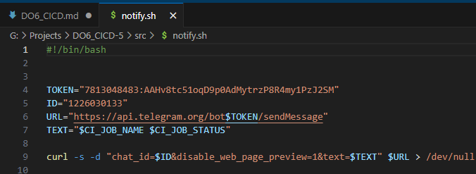
3) Имзменим yml файл (добавим во всех стадиях строку after_script)\
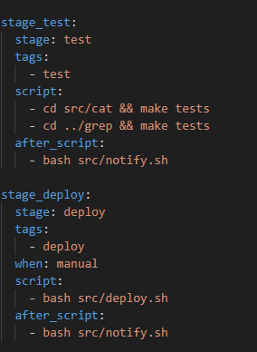

Текст уведомления должен содержать информацию об успешности прохождения как этапа CI, так и этапа CD.
В остальном текст уведомления может быть произвольным.\
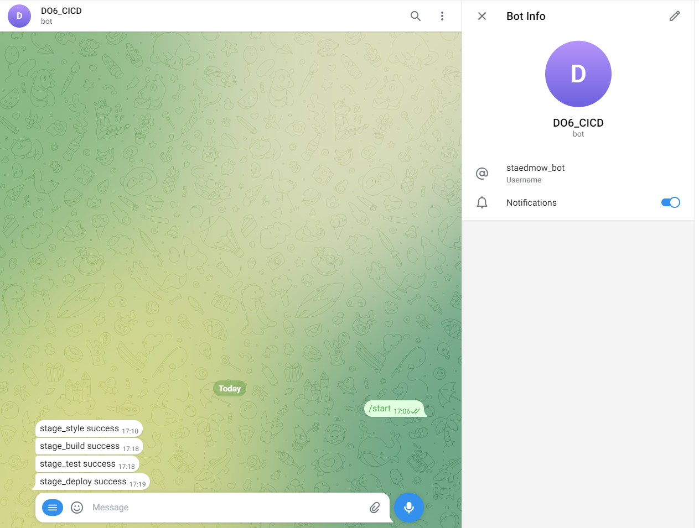